<!--
  ─────────────────────────────────────────────────────────────────────────────
  PROFILE README — MohitSAGAR11/MohitSAGAR11
  Palette: a single amber accent in three luminance steps.
    light theme  #B4690E    dark theme  #F0B429    theme-neutral  #C9871F
  Neutrals: ink #1F2328 / #E6EDF3 · muted #59636E / #8B949E
  Badge fills use the light-theme shade in both themes: shields.io picks white text
  for any mid-brightness colour, which is unreadable on the bright dark-theme shade.
  Search for "PLACEHOLDER" to find everything you need to fill in.

  The card stack at the top and the four repo cards in Build Spotlight come from
  .github/scripts/render_cards.py (palette and type from mohitsagar11.github.io),
  re-rendered daily by .github/workflows/contribution-scan.yml. Edit content there.
  ─────────────────────────────────────────────────────────────────────────────
-->

<!-- CARDS — rendered by .github/scripts/render_cards.py into cards/. Delays are staggered
     so the stack plays top to bottom; tiles are 32.5% wide so three sit in a row. -->

  

  
  
  

  

  

 

## About

Backend engineer who reads the spec before trusting the library. I build **APIs**, **microservices** and **RAG pipelines** in Java, Go and Python, and I contribute upstream to Internet Archive's [Open Library](https://github.com/internetarchive/openlibrary) and the [Hyperjump](https://github.com/hyperjump-io) JSON Schema tools, usually by finding a bug, filing it, then fixing it.

 

## Open Source

<!-- Badge counts are live shields.io searches. The query excludes my own repos plus
     tutorial/coursework repos — keep it in sync with EXCLUDED_REPOS in
     .github/scripts/open-source.js. -->

  <a href="https://github.com/search?q=is%3Apr%20author%3AMohitSAGAR11%20-user%3AMohitSAGAR11%20-repo%3Afirstcontributions%2Ffirst-contributions%20-repo%3ANency-Ravaliya%2Fdevops-heros%20is%3Amerged&type=pullrequests">
    <picture>
      <source media="(prefers-color-scheme: dark)"  srcset="https://img.shields.io/github/issues-search?query=is%3Apr%20author%3AMohitSAGAR11%20-user%3AMohitSAGAR11%20-repo%3Afirstcontributions%2Ffirst-contributions%20-repo%3ANency-Ravaliya%2Fdevops-heros%20is%3Amerged&style=flat-square&label=merged%20upstream%20PRs&color=B4690E&labelColor=30363D&logo=github&logoColor=E6EDF3">
      <source media="(prefers-color-scheme: light)" srcset="https://img.shields.io/github/issues-search?query=is%3Apr%20author%3AMohitSAGAR11%20-user%3AMohitSAGAR11%20-repo%3Afirstcontributions%2Ffirst-contributions%20-repo%3ANency-Ravaliya%2Fdevops-heros%20is%3Amerged&style=flat-square&label=merged%20upstream%20PRs&color=B4690E&labelColor=1F2328&logo=github&logoColor=F6F8FA">
      
    </picture>
  </a>
  <a href="https://github.com/search?q=is%3Apr%20author%3AMohitSAGAR11%20-user%3AMohitSAGAR11%20-repo%3Afirstcontributions%2Ffirst-contributions%20-repo%3ANency-Ravaliya%2Fdevops-heros%20is%3Aopen%20-is%3Adraft&type=pullrequests">
    <picture>
      <source media="(prefers-color-scheme: dark)"  srcset="https://img.shields.io/github/issues-search?query=is%3Apr%20author%3AMohitSAGAR11%20-user%3AMohitSAGAR11%20-repo%3Afirstcontributions%2Ffirst-contributions%20-repo%3ANency-Ravaliya%2Fdevops-heros%20is%3Aopen%20-is%3Adraft&style=flat-square&label=in%20review&color=B4690E&labelColor=30363D&logo=github&logoColor=E6EDF3">
      <source media="(prefers-color-scheme: light)" srcset="https://img.shields.io/github/issues-search?query=is%3Apr%20author%3AMohitSAGAR11%20-user%3AMohitSAGAR11%20-repo%3Afirstcontributions%2Ffirst-contributions%20-repo%3ANency-Ravaliya%2Fdevops-heros%20is%3Aopen%20-is%3Adraft&style=flat-square&label=in%20review&color=B4690E&labelColor=1F2328&logo=github&logoColor=F6F8FA">
      
    </picture>
  </a>

<table>
  <tr>
    <td width="48" valign="top"></td>
    <td valign="top">
      <b><a href="https://github.com/internetarchive/openlibrary">Open Library</a></b> · Internet Archive &nbsp;Python · ★ 6.8k 
      Catalog import &amp; MARC record matching · FastAPI test setup · design-system UI components
    </td>
  </tr>
  <tr>
    <td width="48" valign="top"></td>
    <td valign="top">
      <b><a href="https://github.com/hyperjump-io">Hyperjump</a></b> · JSON Schema validator &amp; URI library &nbsp;JavaScript · ★ 314 
      Spec-compliance bugs in schema validation, error reporting and RFC 3986 URI resolution: found, reported, fixed
    </td>
  </tr>
</table>

<!-- Latest upstream PRs as a git graph — redrawn daily by .github/workflows/open-source.yml -->

  <picture>
    <source media="(prefers-color-scheme: dark)"  srcset="https://raw.githubusercontent.com/MohitSAGAR11/MohitSAGAR11/main/assets/oss-timeline-dark.svg?v=amber">
    <source media="(prefers-color-scheme: light)" srcset="https://raw.githubusercontent.com/MohitSAGAR11/MohitSAGAR11/main/assets/oss-timeline-light.svg?v=amber">
    
  </picture>

  
<b>All upstream pull requests</b> — refreshed daily by GitHub Actions

<!-- OSS-LIST:START -->
- **[internetarchive/openlibrary](https://github.com/internetarchive/openlibrary)** — 10 merged · 3 in review
  - `in review` [#14349](https://github.com/internetarchive/openlibrary/pull/14349) fix(import): route ISBNs by canonical form, not raw string length
  - `merged` [#14198](https://github.com/internetarchive/openlibrary/pull/14198) Strip presentation, diff and tracking params from rel=canonical
  - `merged` [#14054](https://github.com/internetarchive/openlibrary/pull/14054) feat(acquisitions): carry the OPDS source publication and feed name
  - `merged` [#14024](https://github.com/internetarchive/openlibrary/pull/14024) fix(match): match authors regardless of name order
  - `in review` [#14007](https://github.com/internetarchive/openlibrary/pull/14007) feat(tags): add a dashboard for exploring tags by type
  - `merged` [#14002](https://github.com/internetarchive/openlibrary/pull/14002) Pass the base URL to dynlinks explicitly instead of setting `web.ctx.home` in `/api/books` and `/api/volumes`
  - `in review` [#13941](https://github.com/internetarchive/openlibrary/pull/13941) fix(lenny): an unreadable node body is unreachable, not zero loans
  - `merged` [#13888](https://github.com/internetarchive/openlibrary/pull/13888) fix(marc): Keep the MARC $c title out of the author name
  - `merged` [#13880](https://github.com/internetarchive/openlibrary/pull/13880) Build the FastAPI test app with LOCAL_DEV off
  - `merged` [#13751](https://github.com/internetarchive/openlibrary/pull/13751) Name the records in the author merge confirmation
  - `merged` [#13750](https://github.com/internetarchive/openlibrary/pull/13750) Document the button-order convention
  - `merged` [#13718](https://github.com/internetarchive/openlibrary/pull/13718) Status page: four small UI/UX improvements
  - `merged` [#13671](https://github.com/internetarchive/openlibrary/pull/13671) refactor: replace the My Book Notes modal with ol-dialog
- **[hyperjump-io/json-schema](https://github.com/hyperjump-io/json-schema)** — 1 merged · 2 in review
  - `in review` [#146](https://github.com/hyperjump-io/json-schema/pull/146) Throw when registering over a schema with a different $id
  - `in review` [#140](https://github.com/hyperjump-io/json-schema/pull/140) Fix multipleOf for small divisors and large values
  - `merged` [#134](https://github.com/hyperjump-io/json-schema/pull/134) Reject an invalid schema every time it's validated
- **[hyperjump-io/json-schema-errors](https://github.com/hyperjump-io/json-schema-errors)** — 1 merged · 1 in review
  - `in review` [#303](https://github.com/hyperjump-io/json-schema-errors/pull/303) fix: report false schemas under propertyNames
  - `merged` [#296](https://github.com/hyperjump-io/json-schema-errors/pull/296) fix: support content and OpenAPI keywords
- **[json-schema-org/JSON-Schema-Test-Suite](https://github.com/json-schema-org/JSON-Schema-Test-Suite)** — 1 merged · 1 in review
  - `in review` [#1262](https://github.com/json-schema-org/JSON-Schema-Test-Suite/pull/1262) test(multipleOf): add cases for instances much smaller than the divisor
  - `merged` [#1254](https://github.com/json-schema-org/JSON-Schema-Test-Suite/pull/1254) test(multipleOf): add very small divisor and large integer cases
- **[hyperjump-io/json-language-server](https://github.com/hyperjump-io/json-language-server)** — 1 merged
  - `merged` [#186](https://github.com/hyperjump-io/json-language-server/pull/186) Report a $schema that isn't a string
- **[hyperjump-io/uri](https://github.com/hyperjump-io/uri)** — 1 merged
  - `merged` [#12](https://github.com/hyperjump-io/uri/pull/12) Remove dot segments correctly in paths that don't start with a slash
- **[vimalyad/classical_machine_learning](https://github.com/vimalyad/classical_machine_learning)** — 1 merged
  - `merged` [#1](https://github.com/vimalyad/classical_machine_learning/pull/1) Random Forest Classification with Hyperparameter Tuning
- **[hyperjump-io/json-schema-formats](https://github.com/hyperjump-io/json-schema-formats)** — 1 in review
  - `in review` [#27](https://github.com/hyperjump-io/json-schema-formats/pull/27) Handle address literal tags the same way in isEmail and isIdnEmail
- **[internetarchive/infogami](https://github.com/internetarchive/infogami)** — 1 in review
  - `in review` [#284](https://github.com/internetarchive/infogami/pull/284) Resolve only the matching property in Thing.get_property
<!-- OSS-LIST:END -->

 

## Build Spotlight

<!-- Repo cards, rendered by .github/scripts/render_cards.py — edit REPOS there.
     The card links to the repo; the line under it is the live demo. -->

   
  <a href="https://rag-notebook-lm.netlify.app/">Live demo ↗</a>

   
  <a href="https://prism-demo-0cud.onrender.com">Live demo ↗</a>

   
  <a href="https://codefang-playground.onrender.com">Live demo ↗</a>

   
  <a href="https://frontend-rho-teal-32.vercel.app">Live demo ↗</a>

 

## Stack, with receipts

<!-- STACK:START — generated by .github/scripts/stack-receipts.js; edit there, not here -->

  <picture>
    <source media="(prefers-color-scheme: dark)"  srcset="https://raw.githubusercontent.com/MohitSAGAR11/MohitSAGAR11/main/assets/stack/header-dark.svg?v=amber">
    <source media="(prefers-color-scheme: light)" srcset="https://raw.githubusercontent.com/MohitSAGAR11/MohitSAGAR11/main/assets/stack/header-light.svg?v=amber">
    
  </picture> 
  <a href="https://github.com/MohitSAGAR11/Distributed_Cache"><picture>
      <source media="(prefers-color-scheme: dark)"  srcset="https://raw.githubusercontent.com/MohitSAGAR11/MohitSAGAR11/main/assets/stack/distributed-cache-dark.svg?v=amber">
      <source media="(prefers-color-scheme: light)" srcset="https://raw.githubusercontent.com/MohitSAGAR11/MohitSAGAR11/main/assets/stack/distributed-cache-light.svg?v=amber">
      
    </picture></a> 
  <a href="https://github.com/MohitSAGAR11/Rate_Limiter"><picture>
      <source media="(prefers-color-scheme: dark)"  srcset="https://raw.githubusercontent.com/MohitSAGAR11/MohitSAGAR11/main/assets/stack/rate-limiter-dark.svg?v=amber">
      <source media="(prefers-color-scheme: light)" srcset="https://raw.githubusercontent.com/MohitSAGAR11/MohitSAGAR11/main/assets/stack/rate-limiter-light.svg?v=amber">
      
    </picture></a> 
  <a href="https://github.com/MohitSAGAR11/Uber"><picture>
      <source media="(prefers-color-scheme: dark)"  srcset="https://raw.githubusercontent.com/MohitSAGAR11/MohitSAGAR11/main/assets/stack/uber-dark.svg?v=amber">
      <source media="(prefers-color-scheme: light)" srcset="https://raw.githubusercontent.com/MohitSAGAR11/MohitSAGAR11/main/assets/stack/uber-light.svg?v=amber">
      
    </picture></a> 
  <a href="https://github.com/MohitSAGAR11/http11-calculator"><picture>
      <source media="(prefers-color-scheme: dark)"  srcset="https://raw.githubusercontent.com/MohitSAGAR11/MohitSAGAR11/main/assets/stack/http11-calculator-dark.svg?v=amber">
      <source media="(prefers-color-scheme: light)" srcset="https://raw.githubusercontent.com/MohitSAGAR11/MohitSAGAR11/main/assets/stack/http11-calculator-light.svg?v=amber">
      
    </picture></a> 
  <a href="https://github.com/MohitSAGAR11/PRism"><picture>
      <source media="(prefers-color-scheme: dark)"  srcset="https://raw.githubusercontent.com/MohitSAGAR11/MohitSAGAR11/main/assets/stack/prism-dark.svg?v=amber">
      <source media="(prefers-color-scheme: light)" srcset="https://raw.githubusercontent.com/MohitSAGAR11/MohitSAGAR11/main/assets/stack/prism-light.svg?v=amber">
      
    </picture></a> 
  <a href="https://github.com/MohitSAGAR11/typeahead-system"><picture>
      <source media="(prefers-color-scheme: dark)"  srcset="https://raw.githubusercontent.com/MohitSAGAR11/MohitSAGAR11/main/assets/stack/typeahead-system-dark.svg?v=amber">
      <source media="(prefers-color-scheme: light)" srcset="https://raw.githubusercontent.com/MohitSAGAR11/MohitSAGAR11/main/assets/stack/typeahead-system-light.svg?v=amber">
      
    </picture></a> 
  <a href="https://github.com/MohitSAGAR11/Notebook-LM"><picture>
      <source media="(prefers-color-scheme: dark)"  srcset="https://raw.githubusercontent.com/MohitSAGAR11/MohitSAGAR11/main/assets/stack/notebook-lm-dark.svg?v=amber">
      <source media="(prefers-color-scheme: light)" srcset="https://raw.githubusercontent.com/MohitSAGAR11/MohitSAGAR11/main/assets/stack/notebook-lm-light.svg?v=amber">
      
    </picture></a> 
  <a href="https://github.com/MohitSAGAR11/Hierarchical-Navigable-Small-World-HSNW-"><picture>
      <source media="(prefers-color-scheme: dark)"  srcset="https://raw.githubusercontent.com/MohitSAGAR11/MohitSAGAR11/main/assets/stack/hnsw-dark.svg?v=amber">
      <source media="(prefers-color-scheme: light)" srcset="https://raw.githubusercontent.com/MohitSAGAR11/MohitSAGAR11/main/assets/stack/hnsw-light.svg?v=amber">
      
    </picture></a> 
  <a href="https://github.com/MohitSAGAR11/website-automation-agent"><picture>
      <source media="(prefers-color-scheme: dark)"  srcset="https://raw.githubusercontent.com/MohitSAGAR11/MohitSAGAR11/main/assets/stack/website-automation-agent-dark.svg?v=amber">
      <source media="(prefers-color-scheme: light)" srcset="https://raw.githubusercontent.com/MohitSAGAR11/MohitSAGAR11/main/assets/stack/website-automation-agent-light.svg?v=amber">
      
    </picture></a> 
  <a href="https://github.com/MohitSAGAR11/devops-assignment/tree/main/Monitorting_Observability_GitOps"><picture>
      <source media="(prefers-color-scheme: dark)"  srcset="https://raw.githubusercontent.com/MohitSAGAR11/MohitSAGAR11/main/assets/stack/devops-monitoring-dark.svg?v=amber">
      <source media="(prefers-color-scheme: light)" srcset="https://raw.githubusercontent.com/MohitSAGAR11/MohitSAGAR11/main/assets/stack/devops-monitoring-light.svg?v=amber">
      
    </picture></a> 
  <a href="https://github.com/MohitSAGAR11/devops-assignment/tree/main/Cloud_and_Terraform_in_Action"><picture>
      <source media="(prefers-color-scheme: dark)"  srcset="https://raw.githubusercontent.com/MohitSAGAR11/MohitSAGAR11/main/assets/stack/devops-terraform-dark.svg?v=amber">
      <source media="(prefers-color-scheme: light)" srcset="https://raw.githubusercontent.com/MohitSAGAR11/MohitSAGAR11/main/assets/stack/devops-terraform-light.svg?v=amber">
      
    </picture></a> 
  <picture>
    <source media="(prefers-color-scheme: dark)"  srcset="https://raw.githubusercontent.com/MohitSAGAR11/MohitSAGAR11/main/assets/stack/footer-dark.svg?v=amber">
    <source media="(prefers-color-scheme: light)" srcset="https://raw.githubusercontent.com/MohitSAGAR11/MohitSAGAR11/main/assets/stack/footer-light.svg?v=amber">
    
  </picture>

Java · concurrency · design patterns · Spring Boot · MongoDB · JWT · Go · TypeScript · GitHub Actions · Redis · Kafka · PostgreSQL · RAG · LangChain · Pinecone · Python · vector search · Playwright · LLM agents · Kubernetes · Helm · Argo CD · Prometheus · Terraform · AWS
<!-- STACK:END -->

 

## Focus

<!-- `cat ~/.plan` card. Items live in .github/scripts/plan-card.js — edit there and
     re-run it rather than editing the two SVGs by hand. -->

  <picture>
    <source media="(prefers-color-scheme: dark)"  srcset="https://raw.githubusercontent.com/MohitSAGAR11/MohitSAGAR11/main/assets/plan-dark.svg?v=amber">
    <source media="(prefers-color-scheme: light)" srcset="https://raw.githubusercontent.com/MohitSAGAR11/MohitSAGAR11/main/assets/plan-light.svg?v=amber">
    
  </picture>

 

## Signal

  <!-- Contribution scan — re-rendered daily by .github/workflows/contribution-scan.yml -->
  <picture>
    <source media="(prefers-color-scheme: dark)"  srcset="https://raw.githubusercontent.com/MohitSAGAR11/MohitSAGAR11/main/assets/contrib-dark.svg?v=amber">
    <source media="(prefers-color-scheme: light)" srcset="https://raw.githubusercontent.com/MohitSAGAR11/MohitSAGAR11/main/assets/contrib-light.svg?v=amber">
    
  </picture>

  
<b>Recent activity</b> — refreshed daily by GitHub Actions

<!-- ACTIVITY:START -->
- `2026-11-10` — created branch `14276/fix/isbn-field-routing` in [MohitSAGAR11/openlibrary](https://github.com/MohitSAGAR11/openlibrary)
- `2026-11-11` — opened PR [#288](https://github.com/internetarchive/infogami/pull/288) in [internetarchive/infogami](https://github.com/internetarchive/infogami)
- `2026-11-11` — opened issue [#14396](https://github.com/internetarchive/openlibrary/issues/14396) in [internetarchive/openlibrary](https://github.com/internetarchive/openlibrary)
- `2026-11-11` — opened PR [#14395](https://github.com/internetarchive/openlibrary/pull/14395) in [internetarchive/openlibrary](https://github.com/internetarchive/openlibrary)
- `2026-11-10` — merged PR [#284](https://github.com/internetarchive/infogami/pull/284) in [internetarchive/infogami](https://github.com/internetarchive/infogami)
<!-- ACTIVITY:END -->

<!-- PLACEHOLDER (optional) — WakaTime coding-time card. Needs a WakaTime account and
     the WAKATIME_API_KEY secret. Replace <WAKATIME-USERNAME> and uncomment.
<picture>
  <source media="(prefers-color-scheme: dark)"  srcset="https://github-readme-stats.vercel.app/api/wakatime?username=<WAKATIME-USERNAME>&layout=compact&hide_border=true&bg_color=00000000&title_color=F0B429&text_color=8B949E">
  <source media="(prefers-color-scheme: light)" srcset="https://github-readme-stats.vercel.app/api/wakatime?username=<WAKATIME-USERNAME>&layout=compact&hide_border=true&bg_color=00000000&title_color=B4690E&text_color=59636E">
  &layout=compact&hide_border=true&bg_color=00000000&title_color=F0B429&text_color=8B949E">
</picture>
-->

 

  <!-- Looping terminal sign-off, the header's bookend. Generated by .github/scripts/footer-svg.js -->
  <picture>
    <source media="(prefers-color-scheme: dark)"  srcset="https://raw.githubusercontent.com/MohitSAGAR11/MohitSAGAR11/main/assets/footer-dark.svg?v=amber">
    <source media="(prefers-color-scheme: light)" srcset="https://raw.githubusercontent.com/MohitSAGAR11/MohitSAGAR11/main/assets/footer-light.svg?v=amber">
    
  </picture>

